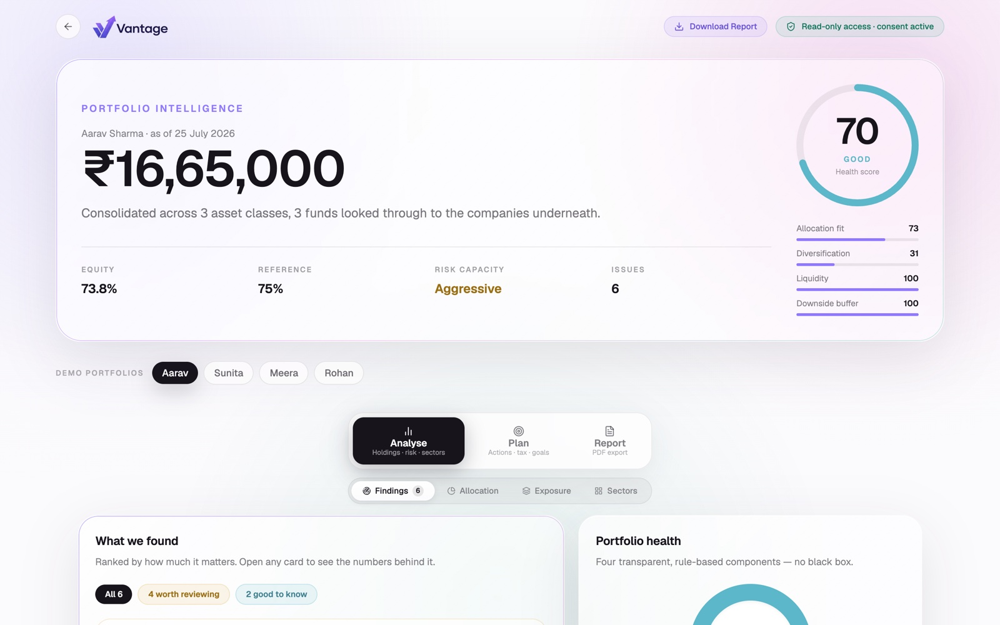
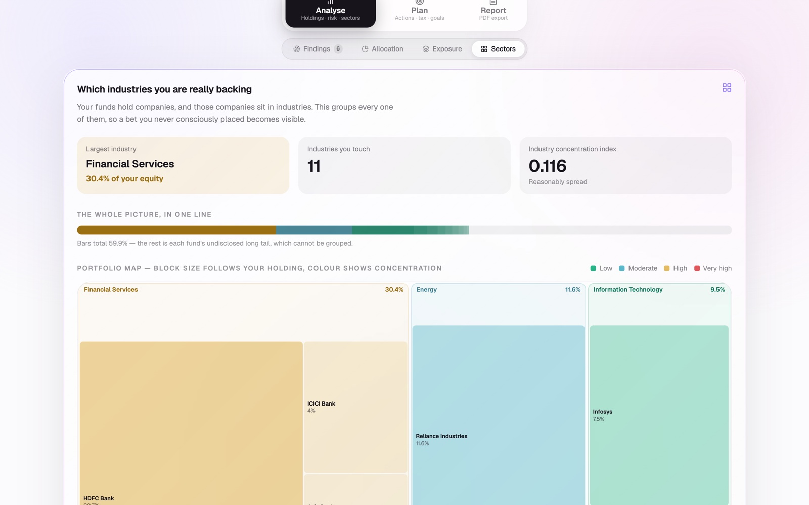
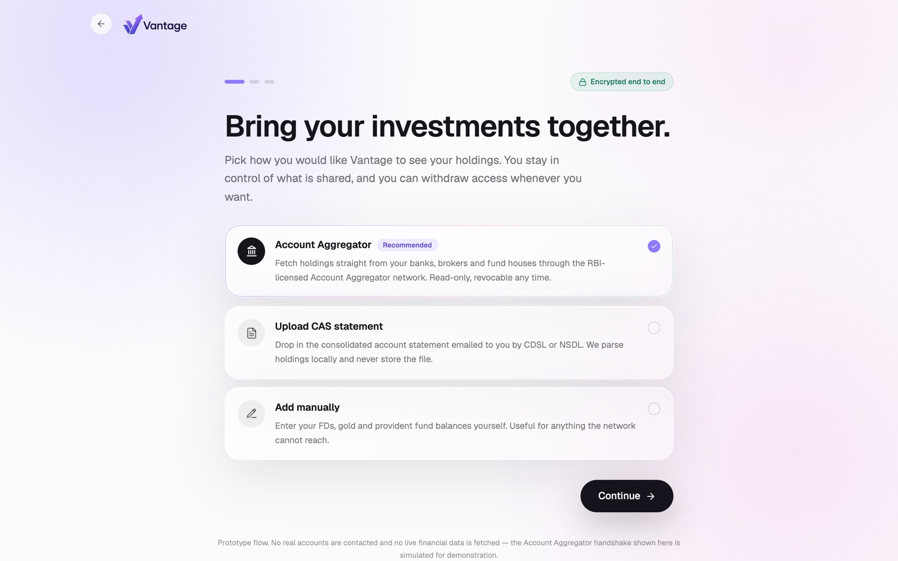
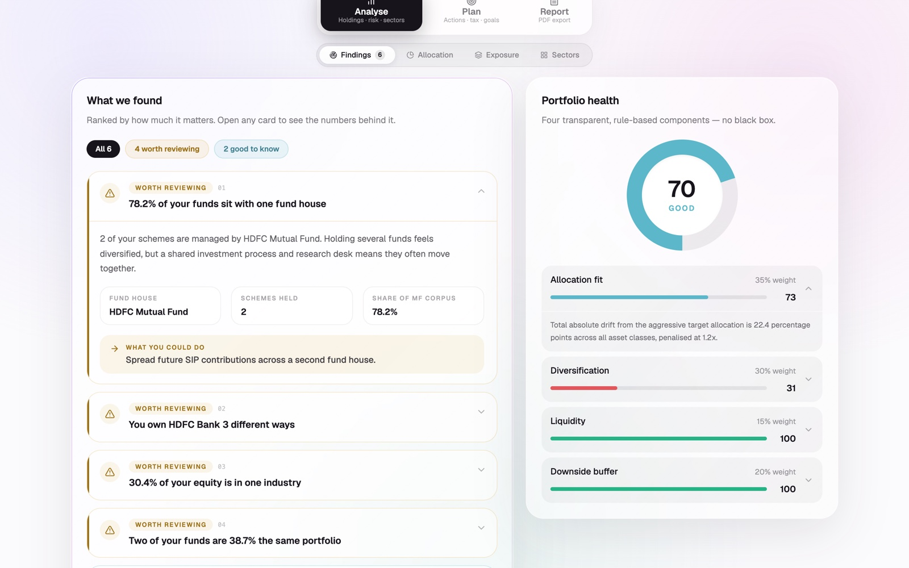

# Vantage

<div align="center">

**Portfolio intelligence for Indian retail investors.**

Consolidates holdings across brokers, mutual funds, EPF, bonds, gold, REITs, and InvITs — then looks *inside* the funds, down to the individual companies, to show what you are actually holding underneath.

[](https://nextjs.org/)
[](https://react.dev/)
[](https://www.typescriptlang.org/)
[](https://tailwindcss.com/)
[](https://aistudio.google.com/)
[](LICENSE)

</div>

---

> **Prototype using synthetic data.** Every holding, unit count, value, and folio number in this repository is invented for demonstration. Vantage is a read-only analysis layer — it never holds, moves, or manages money, and it is not a registered investment adviser.

---



---

## Table of Contents

- [The Problem It Solves](#the-problem-it-solves)
- [What Makes the Numbers Trustworthy](#what-makes-the-numbers-trustworthy)
- [Key Features](#key-features)
- [Quick Start](#quick-start)
- [Application Routes & APIs](#application-routes--apis)
- [Bundled Demo Portfolios](#bundled-demo-portfolios)
- [System Architecture](#system-architecture)
- [Analytics Engine](#the-analytics-engine)
- [Technology Stack](#technology-stack)
- [Known Limitations](#known-limitations)
- [Documentation Index](#documentation)
- [License](#license)

---

## The Problem It Solves

Two funds can carry different names, different investment mandates, and different asset management companies (AMCs), yet still own substantially the same underlying companies. That duplication is invisible at the fund level, creating an unhedged risk retail investors are least equipped to detect.

In the bundled demo portfolio:
- **HDFC Bank** is reached through three separate channels: bought directly as equity shares, held inside HDFC Flexi Cap, and held inside ICICI Prudential Bluechip.
- Counting only directly held shares, HDFC Bank appears to be **16.3%** of the equity allocation.
- Looking *through* the funds, the true effective exposure is **20.7%**.
- Two of the portfolio's core mutual funds share **38.7% of the exact same book of stocks**.


*Each bar represents one underlying company; segments indicate every route through which capital reaches it.*

Group those companies by industry, and unintended concentrations emerge: **30.4%** of equity in Financial Services, spread across seven companies reached through three separate funds plus direct equity accounts.



---

## What Makes the Numbers Trustworthy

Every score is pure arithmetic evaluated on disclosed inputs. There is no trained machine learning model anywhere in the analytics path, and every figure can be verified by hand from [**`docs/METHODOLOGY.md`**](docs/METHODOLOGY.md).

Vantage follows strict design rules:

- **Explanation travels with the number.** Every computed object carries a human-readable `why` string generated alongside the calculation. The UI never has to reconstruct or infer the reasoning.
- **Understate rather than overstate.** Mutual fund factsheets disclose top holdings, not the complete book. Portfolio coverage is reported explicitly (e.g., 42.1% in the demo portfolio), and every overlap metric is a mathematical floor — *at least this much duplication, never less*.
- **The AI explains, never calculates.** The AI language model receives pre-calculated numbers and is strictly constrained by guardrails from producing new numbers, predicting returns, or recommending securities.

---

## Key Features

- **Look-Through Fund Overlap Engine**: Unpacks mutual fund portfolios to compute true pairwise overlap and aggregate cross-holding weights.
- **Dynamic Sector Treemap**: Interactive squarified treemap revealing true economic sector and industry exposure.
- **Composite Health Score (0–100)**: Transparent weighted rating spanning asset allocation, risk fit, concentration, and overlap.
- **Objective Risk Capacity Assessment**: Evaluates investment horizon, dependency ratio, monthly cash flows, and emergency buffer to determine true risk-bearing capacity.
- **Deterministic Findings Engine**: Generates severity-ranked diagnostic insights (`critical`, `warning`, `notice`, `info`) with step-by-step mathematical proofs.
- **What-If Shock Simulator**: Simulates portfolio resilience and capital at risk under market drawdown scenarios (-15%, -30%).
- **Streaming Explainable AI Narrative**: Translates complex financial metrics into calm, accessible guidance using Google Gemini 2.5 Flash.
- **Print-Ready PDF Audit Report**: Generates a nine-section portfolio review via headless Chrome (Puppeteer).

| | |
|:---:|:---:|
|  |  |
| `/` — Landing page | `/connect` — Consent-first onboarding |



*Findings ranked by severity. Every card expands to reveal the exact mathematical arithmetic.*

---

## Quick Start

### 1. Prerequisites
- **Node.js**: v18.17.0 or higher
- **npm** (or `pnpm` / `yarn`)

### 2. Clone and Install
```bash
git clone https://github.com/Hariharaaa/Vantage.git
cd Vantage
npm install
```

### 3. Setup Headless Chrome (for PDF export)
Puppeteer requires a matching Chrome browser binary:
```bash
npx puppeteer browsers install chrome
```

### 4. Configure Environment Variables
Copy `.env.example` to `.env`:
```bash
cp .env.example .env
```

Open `.env` and configure your Google Gemini API key:
```env
# Required for the streaming plain-language narrative on /dashboard
# Get a key at https://aistudio.google.com/apikey
GEMINI_API_KEY=your_gemini_api_key_here
```
*(Note: Everything else — the analytics engine, charts, overlap matrix, findings, and PDF export — runs locally without an API key).*

### 5. Launch Development Server
```bash
npm run dev
```
Open [http://localhost:3000](http://localhost:3000) in your browser.

---

## Application Routes & APIs

### Pages
| Route | Description |
|---|---|
| `/` | Landing page introducing the problem and methodology |
| `/connect` | Consent-first onboarding (Account Aggregator, CAS statement upload, sample personas) |
| `/dashboard` | Main analytics dashboard (Health score, overlap, industry treemap, findings, simulator) |
| `/report` | Print-styled document view optimized for PDF generation |

### API Endpoints
| Endpoint | Method | Description |
|---|:---:|---|
| `/api/analyze` | `GET` / `POST` | Executes the pure TypeScript analytics engine; returns complete `PortfolioAnalysis` JSON |
| `/api/narrate` | `GET` / `POST` | Streams plain-language explanation generated by Gemini 2.5 Flash with strict guardrails |
| `/api/report` | `GET` | Uses Puppeteer to render `/report` into a 9-section downloadable PDF |

---

## Bundled Demo Portfolios

Four distinct mock retail investor personas are bundled to test various portfolio dynamics:

```
/dashboard?portfolio=aarav     # Health: 70 (Good)   · Capacity: 86 (Aggressive)  · Hidden fund overlap & financial concentration
/dashboard?portfolio=sunita    # Health: 56 (Fair)   · Capacity: 31 (Conservative)· Near retirement, needs liquidity & debt cushion
/dashboard?portfolio=meera     # Health: 82 (Strong) · Capacity: 63 (Moderate)    · Well-balanced multi-asset diversification
/dashboard?portfolio=rohan     # Health: 44 (Poor)   · Capacity: 86 (Aggressive)  · High single-stock and tech sector concentration
```

For more details on personas and custom portfolio formats, see [**`data/README.md`**](data/README.md).

---

## The Analytics Engine

The engine consists of eleven pure, testable modules located under [**`lib/analytics/`**](lib/analytics/README.md), orchestrated in a single pass:

| Module | File | Purpose |
|---|---|---|
| Schema Definitions | `types/portfolio.ts` · `types/analysis.ts` | Type definitions for input portfolios and analytical output |
| Fund Asset Mixes | `lib/analytics/fund-taxonomy.ts` | SEBI mutual fund category decomposition |
| Risk Capacity | `lib/analytics/risk-profile.ts` | Objective scoring based on horizon, age, and dependency |
| Allocation & Drift | `lib/analytics/allocation.ts` | Multi-asset class aggregation and drift vs. target heuristics |
| Concentration & HHI | `lib/analytics/concentration.ts` | Herfindahl-Hirschman Index and top issuer exposures |
| Look-Through Overlap | `lib/analytics/overlap.ts` | Cross-fund holding aggregation and pairwise duplication |
| Benchmark Comparison | `lib/analytics/benchmark.ts` | Shape comparison against standard asset allocation baselines |
| What-If Simulation | `lib/analytics/simulate.ts` | Stress testing under market drawdowns |
| Health Score | `lib/analytics/health-score.ts` | Composite 0–100 weighted evaluation rating |
| Findings Engine | `lib/analytics/findings.ts` | Deterministic severity-ranked diagnostic rules |
| Instrument Matching | `lib/analytics/instrument-match.ts` | Rebalancing categories without commercial bias |
| AI Guardrails | `lib/ai/narrative-prompt.ts` | System prompts enforcing mathematical honesty |

See [**`lib/analytics/README.md`**](lib/analytics/README.md) for module-level architectural documentation.

---

## Technology Stack

- **Framework**: [Next.js 15](https://nextjs.org/) (App Router, Server-side rendering, API routes)
- **UI Library**: [React 19](https://react.dev/)
- **Styling**: [Tailwind CSS v4](https://tailwindcss.com/)
- **Animation**: [Framer Motion](https://www.framer.com/motion/)
- **Data Visualization**: [Recharts](https://recharts.org/) & Custom SVG Treemaps
- **AI Narrative**: [Google Gen AI SDK (`@google/genai`)](https://www.npmjs.com/package/@google/genai) — Gemini 2.5 Flash
- **PDF Generation**: [Puppeteer](https://pptr.dev/) (Headless Chrome rendering)
- **Language**: [TypeScript](https://www.typescriptlang.org/) (Strict type checking)

---

## Known Limitations

A methodology that only lists strengths is not honest. Vantage documents its operational constraints openly (see [**`docs/METHODOLOGY.md §11`**](docs/METHODOLOGY.md)):

- **Partial Factsheet Coverage**: Factsheets disclose top 30–50 holdings; overlap and issuer concentrations are guaranteed mathematical floors, not exact totals.
- **Monthly Reporting Latency**: Disclosed fund portfolios reflect monthly portfolio disclosures (lagging by 15–30 days).
- **Target Allocation Heuristics**: Reference allocations are conventional financial planning heuristics, not individualized investment advice.
- **Taxation Modeling**: Capital gains tax liabilities (STCG/LTCG) are not modeled in rebalancing suggestions.
- **Insurance & Liabilities**: Risk capacity scoring currently omits outstanding debts and health/life insurance status.

---

## Documentation

- [**Analytics Methodology Whitepaper** (`docs/METHODOLOGY.md`)](docs/METHODOLOGY.md): Comprehensive 500+ line technical specification.
- [**Analytics Engine Architecture** (`lib/analytics/README.md`)](lib/analytics/README.md): Pipeline flow and module breakdown.
- [**Datasets & Personas Guide** (`data/README.md`)](data/README.md): Synthetic mock portfolios and custom schema guide.
- [**UI Components Guide** (`components/README.md`)](components/README.md): Component library and design system.
- [**Documentation Index** (`docs/README.md`)](docs/README.md): High-level navigation of project documentation.

---

## License

This project is licensed under the [MIT License](LICENSE).
