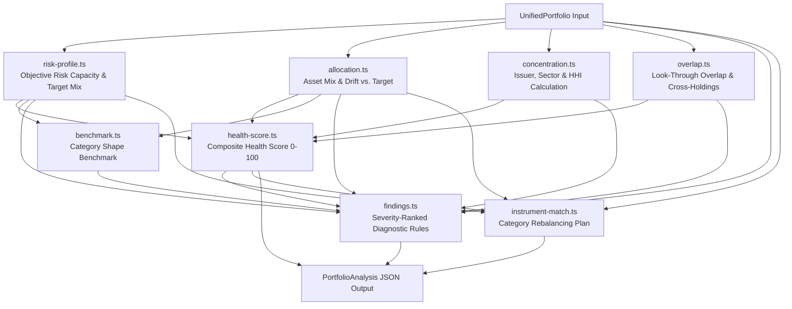

# Vantage Analytics Engine (`lib/analytics`)

The Vantage analytics engine is a pure, zero-dependency TypeScript engine that executes deterministic portfolio diagnostics for Indian retail investors.

Every number shown in the Vantage user interface is computed by this engine in a single synchronous pass. It does not use machine learning, curve fitting, or stochastic models in any part of the analytics path.

---

## Design Principles

1. **Rule-Based Over Learned**: Every metric is transparent arithmetic calculated on disclosed inputs. There is no black-box ML model generating scores.
2. **Explanation Travels With the Number**: Every metric object includes a human-readable `why` string generated alongside the calculation. The UI renders this directly without guessing or synthesizing the underlying logic.
3. **Understate Rather Than Overstate**: Because mutual fund factsheets disclose only top holdings (typically 30–50 stocks), look-through overlap and concentration calculations represent guaranteed mathematical floors (*"at least this much duplication, never less"*).
4. **Separation of Diagnosis and Action**: The diagnostic modules evaluate what is true about the portfolio. The instrument matcher determines rebalancing actions. Both modules run independently.
5. **AI Explains, Never Calculates**: The AI narrative layer (`lib/ai/`) only formats pre-computed numbers into plain prose. It is strictly prohibited by system prompt guardrails from computing, altering, or forecasting figures.

---

## Pipeline Architecture



---

## Module Breakdown

| Module | Purpose | Key Outputs |
|---|---|---|
| [`index.ts`](file:///Users/harihara/Downloads/Vantage-main/lib/analytics/index.ts) | Pipeline orchestrator | Composes all modules in a single pass via `analysePortfolio()` |
| [`fund-taxonomy.ts`](file:///Users/harihara/Downloads/Vantage-main/lib/analytics/fund-taxonomy.ts) | SEBI mutual fund category decomposition | Asset split mapping (equity, debt, gold, cash) for 17+ fund categories |
| [`risk-profile.ts`](file:///Users/harihara/Downloads/Vantage-main/lib/analytics/risk-profile.ts) | Objective risk capacity scoring | Risk capacity score (0–100), derived risk tier, and target asset allocation |
| [`allocation.ts`](file:///Users/harihara/Downloads/Vantage-main/lib/analytics/allocation.ts) | Asset allocation & drift analysis | Effective asset class weights, net allocation, and percentage-point drift |
| [`concentration.ts`](file:///Users/harihara/Downloads/Vantage-main/lib/analytics/concentration.ts) | Concentration & Herfindahl index | Top 5/10 holdings share, sector weights, AMC concentration, and HHI score |
| [`overlap.ts`](file:///Users/harihara/Downloads/Vantage-main/lib/analytics/overlap.ts) | Look-through fund overlap | Stock-level look-through, pairwise fund overlap %, and cross-holding routes |
| [`benchmark.ts`](file:///Users/harihara/Downloads/Vantage-main/lib/analytics/benchmark.ts) | Heuristic benchmark comparison | Divergence against standard asset allocation shapes |
| [`health-score.ts`](file:///Users/harihara/Downloads/Vantage-main/lib/analytics/health-score.ts) | Composite portfolio health rating | Overall score (0–100) and sub-scores for allocation, concentration, overlap, and risk fit |
| [`findings.ts`](file:///Users/harihara/Downloads/Vantage-main/lib/analytics/findings.ts) | Severity-ranked diagnostic rule engine | List of structured findings (`critical`, `warning`, `notice`, `info`) with arithmetic derivations |
| [`simulate.ts`](file:///Users/harihara/Downloads/Vantage-main/lib/analytics/simulate.ts) | Stress-test & what-if simulator | Portfolio value impact under market shocks (e.g. -15%, -30% equity drawdowns) |
| [`instrument-match.ts`](file:///Users/harihara/Downloads/Vantage-main/lib/analytics/instrument-match.ts) | Action plan & rebalancing taxonomy | Non-commercial category guidance to close identified allocation gaps |

---

## Programmatic Usage

```typescript
import { analysePortfolio } from "@/lib/analytics";
import type { UnifiedPortfolio } from "@/types/portfolio";

// Pass any valid UnifiedPortfolio object
const analysis = analysePortfolio(myPortfolio);

console.log(`Portfolio Health Score: ${analysis.healthScore.overall} / 100`);
console.log(`Risk Capacity: ${analysis.riskProfile.capacityScore} (${analysis.riskProfile.derivedCategory})`);
console.log(`Found ${analysis.findings.length} actionable diagnostic findings.`);
```

---

## Detailed Formulation

For mathematical proofs, formula derivations, threshold constants, and worked examples, see [**`docs/METHODOLOGY.md`**](file:///Users/harihara/Downloads/Vantage-main/docs/METHODOLOGY.md).
